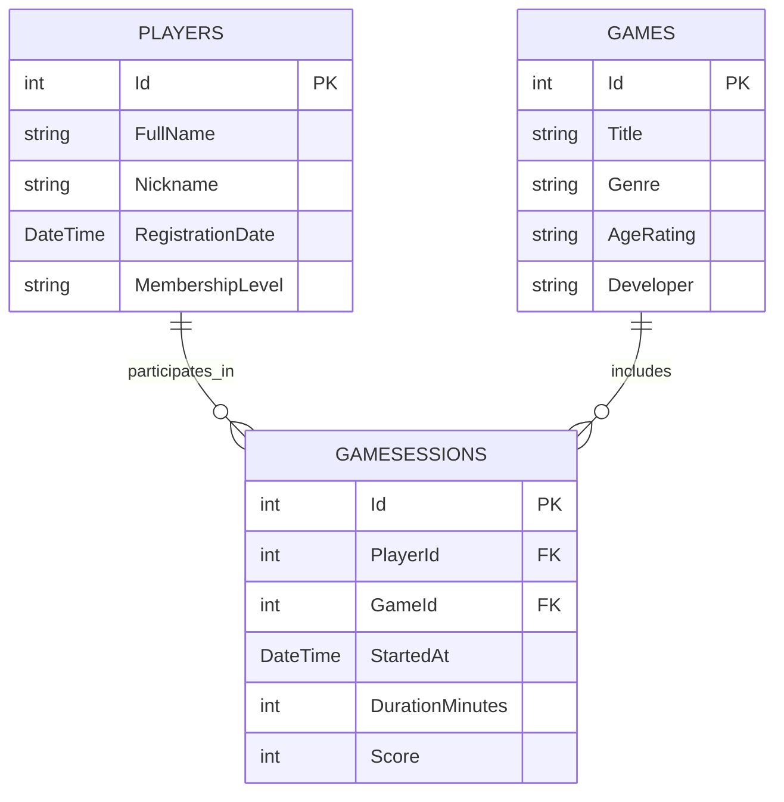

# GameClub Manager

Система учёта игроков, игр и игровых сессий компьютерного клуба.

## Автор

- **Фамилия, имя:** Дьяковский Данил
- **Группа:** рпо 24\1

## Проект

- **Тема:** Информационная система компьютерного клуба.
- **Название заведения:** GameZone.

GameClub Manager — приложение для организации работы компьютерного клуба GameZone. Система позволяет вести список зарегистрированных игроков и доступных игр, а также сохранять информацию о проведённых игровых сессиях. Каждый игрок может играть в разные игры, а в одну игру могут играть разные игроки. Благодаря этому можно просматривать историю игровых сессий, продолжительность игры и набранные очки.

## Схема базы данных

## Таблицы

### 1. Players — игроки

Таблица хранит информацию о зарегистрированных посетителях компьютерного клуба.

| Поле | Тип | Обязательное | Описание |
|---|---|---|---|
| Id | int | Да | Уникальный идентификатор игрока |
| FullName | string | Да | Имя и фамилия игрока |
| Nickname | string | Да | Игровой псевдоним |
| RegistrationDate | DateTime | Да | Дата регистрации в клубе |
| MembershipLevel | string | Да | Уровень клубного членства |

### 2. Games — игры

Таблица содержит список игр, доступных посетителям компьютерного клуба.

| Поле | Тип | Обязательное | Описание |
|---|---|---|---|
| Id | int | Да | Уникальный идентификатор игры |
| Title | string | Да | Название игры |
| Genre | string | Да | Жанр игры |
| AgeRating | string | Да | Возрастное ограничение |
| Developer | string | Да | Разработчик игры |

### 3. GameSessions — игровые сессии

Таблица связывает игроков и игры, а также хранит информацию о каждой игровой сессии.

| Поле | Тип | Обязательное | Описание |
|---|---|---|---|
| Id | int | Да | Уникальный идентификатор сессии |
| PlayerId | int | Да | Идентификатор игрока |
| GameId | int | Да | Идентификатор игры |
| StartedAt | DateTime | Да | Дата и время начала сессии |
| DurationMinutes | int | Да | Продолжительность игры в минутах |
| Score | int | Нет | Количество набранных очков |

## Связи между таблицами

Между таблицами **Players** и **Games** реализована связь многие-ко-многим через таблицу **GameSessions**.

- Один игрок может провести игровые сессии во многих играх.
- Одна игра может быть выбрана множеством разных игроков.
- Поле `PlayerId` в таблице `GameSessions` ссылается на `Players.Id`.
- Поле `GameId` в таблице `GameSessions` ссылается на `Games.Id`.

Таблица `GameSessions` является связующей и дополнительно хранит дату начала сессии, её продолжительность и набранные очки. Это позволяет сохранять историю игровых сессий, даже если один и тот же игрок многократно запускает одну игру.